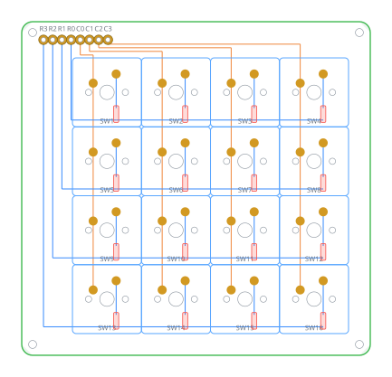
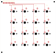
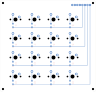

# Makropad 4 × 4 — ZMK

16 Tasten im 19,05-mm-Raster, Cherry MX, gesteuert von einem **nice!nano**
über acht Lötpunkte. Platine **96,2 × 92,2 mm**, zwei Lagen, vollständig
verdrahtet. Firmware ist **ZMK**, die Belegung lässt sich im Browser mit
ZMK Studio ändern — ohne neu zu flashen.



Entwurf, Fertigungsdaten und Firmware liegen hier zusammen. Die Platine ist
nicht von Hand gezeichnet, sondern wird aus einem Skript erzeugt — Rastermaß
und Tastenzahl sind dadurch eine Zahl im Kopf der Datei.

> Dieselbe Platine lässt sich auch mit einem Pro Micro und QMK/Vial
> betreiben. Das liegt bewusst in einem eigenen Repo, damit sich die beiden
> Welten nicht vermischen: [makropad-4x4](https://github.com/deffel6/makropad-4x4).

## Anschlüsse

Acht durchkontaktierte Lötpunkte in einer Reihe am oberen Rand, im
2,54-mm-Raster. Von links:

```
R3  R2  R1  R0  C0  C1  C2  C3
```

| Lötpunkt | Aufdruck am Controller | nice!nano |
|---|---|---|
| `R0` | 4 | P0.22 |
| `R1` | 5 | P0.24 |
| `R2` | 6 | P1.00 |
| `R3` | 7 | P0.11 |
| `C0` | A3 | P0.31 |
| `C1` | A2 | P0.29 |
| `C2` | A1 | P0.02 |
| `C3` | A0 | P1.15 |

Der nice!nano hat dieselbe Pinbelegung wie ein Pro Micro, deshalb passt er
auf dieselben acht Lötpunkte. In der Firmware werden die Pins über die
Pro-Micro-Nummern angesprochen (`&pro_micro 4` und so weiter), die
P-Nummern sind nur der Aufdruck auf dem Modul.

Achtung bei den Spalten: Die Reihenfolge läuft gegenläufig — **C0 liegt auf
A3**, C3 auf A0.

## Verdrahtung

```
Spalte ──── Schalter ──── Diode ──►── Zeile
                          Anode   Kathode
```

Die Diode verhindert Phantomtasten: Ohne sie schließen drei gleichzeitig
gedrückte Tasten einen Pfad über eine vierte, die gar nicht gedrückt ist.
Stromrichtung Spalte → Zeile, in ZMK `col2row`.

Spalten laufen senkrecht auf der Vorderseite, Zeilen waagerecht auf der
Rückseite. Weil jeder Lötpunkt auf der Achse seiner Bahn sitzt, kreuzt sich
nichts — die Platine kommt ohne eine einzige Durchkontaktierung aus.

| Vorderseite | Rückseite |
|---|---|
|  |  |

## Fertigen lassen

`hardware/keypad4x4-gerber.zip` bei einem Hersteller hochladen, nicht
entpacken. Voreinstellungen passen: zweilagig, 1,6 mm, HASL.

Geprüft ist die Platine mit dem Regelprüfer von KiCad 10:

```
Regelverstöße:        0
Unverbundene Stellen: 0
```

Wer die Dioden bestücken lassen will, findet in `bestueckung/` die Stückliste
und die Positionsdatei. Die 16 SOD-123 sitzen auf der **Unterseite**.

## Fürs Gehäuse

`hardware/keypad4x4.step` ist direkt aus der KiCad-Datei exportiert und damit
maßhaltig.

**Das Tastenfeld sitzt nicht mittig auf der Platine:**

| | X | Y |
|---|---|---|
| Platinenmitte | 68,10 | 66,10 |
| Mitte Tastenfeld | 72,10 | 68,10 |
| **Versatz** | **+4,0 mm** | **+2,0 mm** |

Wer die Tastenöffnung mittig in einen Deckel setzt, muss die Platine also um
4 mm nach links und 2 mm nach oben versetzt einbauen. Tastenfeld über die
Kappen: 76,2 × 76,2 mm.

## Stückliste

| Menge | Teil | Hinweis |
|---|---|---|
| 16 | Cherry MX oder kompatibel | **PCB-Bauform mit fünf Beinen** |
| 16 | 1N4148W, SOD-123 | Rückseite, SMD |
| 1 | nice!nano v2 | nRF52840, Pro-Micro-Bauform |
| 1 | Stiftleiste 8-polig, 2,54 mm | |
| 4 | M2-Schraube mit Abstandshalter | Löcher Ø 2,2 mm |
| 1 | LiPo-Akku mit JST-Stecker | nur für den Betrieb ohne Kabel |

Die Schalter brauchen die PCB-montierte Bauform mit zwei Kunststoffzapfen
neben den Kontakten — die Platine hat Löcher dafür. Die Plattenbauform ohne
Zapfen passt zwar hinein, sitzt aber lose.

## Firmware

Die fertige Datei liegt unter [`firmware/keypad4x4_zmk.uf2`](firmware/).
Zum Flashen braucht es kein Programm:

1. **Akku abziehen**, nur das USB-Kabel angesteckt lassen
2. **RST und GND zweimal kurz hintereinander** verbinden, im Takt eines
   Doppelklicks
3. Es erscheint ein Laufwerk **NICENANO**
4. Die `.uf2` daraufziehen

Das Board schreibt sie selbst, startet neu, und das Laufwerk verschwindet.
Die Fehlermeldung, die macOS dabei zeigt, gehört dazu: Das Board hängt sich
mitten im Schreiben selbst aus.

Der Akku muss ab, weil der Doppeltipp sonst oft nicht als zwei getrennte
Resets ankommt.

## Belegung

Steht in [`config/keypad4x4.keymap`](config/keypad4x4.keymap), Tasten von
oben links nach rechts:

| Nr. | | Nr. | |
|---|---|---|---|
| 0 | ⌃⌥⌘H | 8 | ⇧⌘S |
| 1 | ⌃⌥⌘J | 9 | ⌘S |
| 2 | ⌃⌥⌘K | 10 | ⇧⌥⌘C |
| 3 | ⌃⌥⌘L | 11 | ⇧⌘4 |
| 4 | ⌃⌥⌘V | 12 | ⌃⌥⌘B |
| 5 | ⌃⌥⌘W | 13 | ⌘I |
| 6 | ⌃⌥⌘X | 14 | ⇧⌥⌘F |
| 7 | ⌃⌥⌘Y | 15 | ⌃⇧⌘4 |

## Makro und Bootloader

Das Makro **„dg1eaw + Return"** steckt in der Firmware, liegt aber auf keiner
Taste. In ZMK Studio lässt es sich wie jedes andere Verhalten zuweisen.

**Taste 0 und 1 gleichzeitig drücken und zwei Sekunden halten** bringt das
Pad in den Bootloader — das Laufwerk NICENANO erscheint, ohne dass RST und
GND gebrückt werden müssen. Kurzes gemeinsames Antippen bewirkt nichts.

## Ändern

**Im Browser:** [zmk.studio](https://zmk.studio) öffnen, Keypad über USB
verbinden, umbelegen, speichern. Kein Flashen nötig.

> **Der Haken dabei:** Was in ZMK Studio gespeichert wird, liegt im Speicher
> des Keypads und **überstimmt die Firmware** — auch nach jedem neuen
> Flashen. Wer wieder die Belegung aus diesem Repo haben will, löst in Studio
> einmal **„Restore Stock Settings"** aus. Ohne diesen Schritt ändert sich
> durch neue Firmware gar nichts.

**In der Datei:** `config/keypad4x4.keymap` bearbeiten und committen. GitHub
baut die Firmware dann selbst — unter **Actions** liegt die fertige `.uf2`
als Artefakt. Diese Artefakte verfallen nach einiger Zeit, deshalb liegt in
`firmware/` zusätzlich eine Kopie des jeweils aktuellen Standes.

Die Schreibweise der Modifikatoren in ZMK: `LC` Strg, `LS` Umschalt, `LA`
Alt, `LG` Befehl. Geschachtelt ergibt `LC(LA(LG(H)))` also Strg+Alt+Befehl+H.
Ziffern heißen `N0` bis `N9`.

## Blaue LED

Das Modul in `src/tastendruck_led.c` schaltet die blaue LED des nice!nano
beim Start aus und lässt sie bei jedem Tastendruck 40 ms aufleuchten.

Auf manchen nice!nano-Nachbauten hängt die blaue LED **fest an der
Ladeelektronik** statt am Prozessor. Dort blinkt sie weiter, sobald kein
Akku angeschlossen ist, und keine Firmware kann daran etwas ändern.

Abschalten mit `CONFIG_TASTENDRUCK_LED=n`, Dauer über
`CONFIG_TASTENDRUCK_LED_MS`.

## Werkzeuge

| | |
|---|---|
| Platine | KiCad 10, erzeugt aus `hardware/generate_pcb.py` |
| Firmware | ZMK, gebaut von GitHub Actions |
| Belegung | ZMK Studio im Browser |
